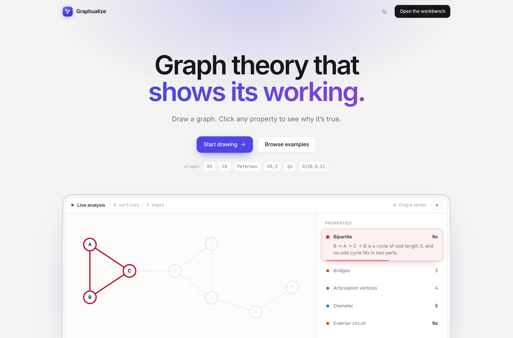
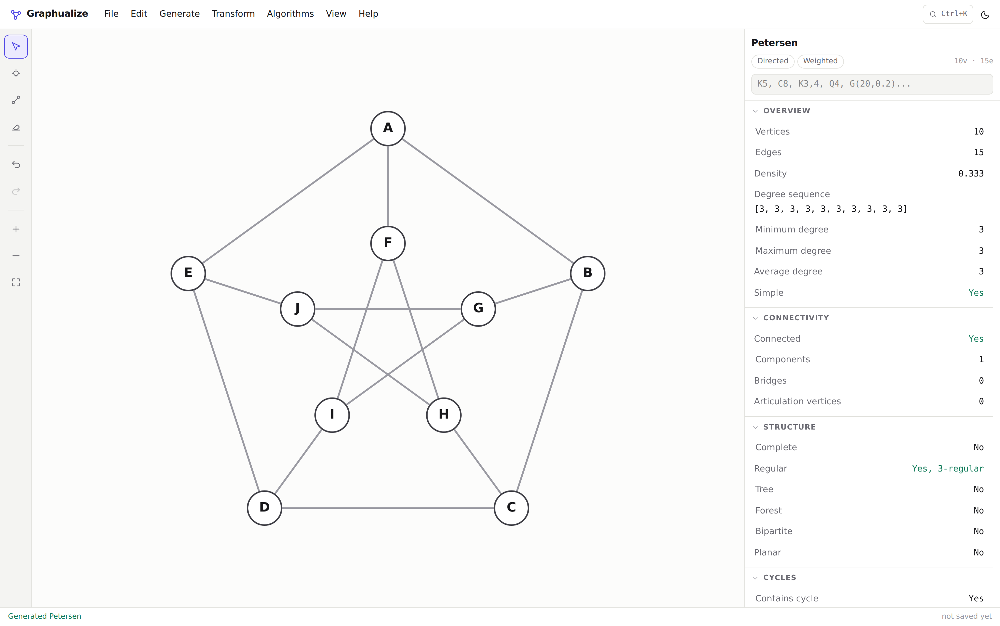
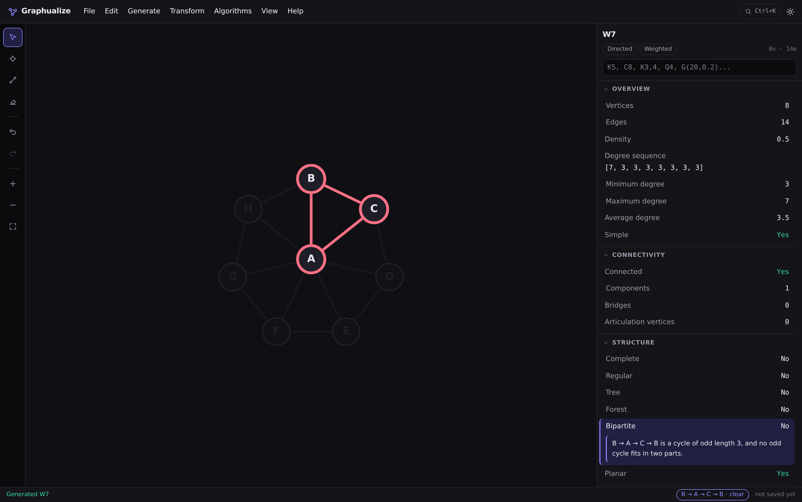
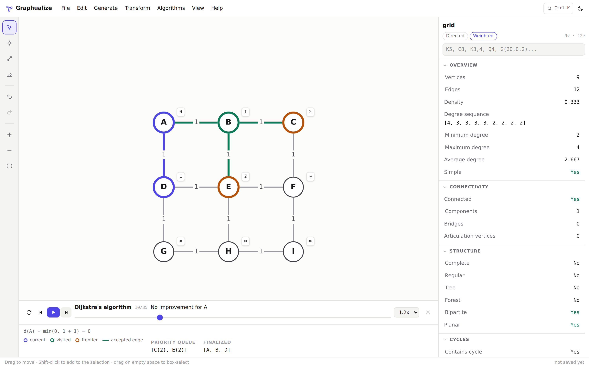
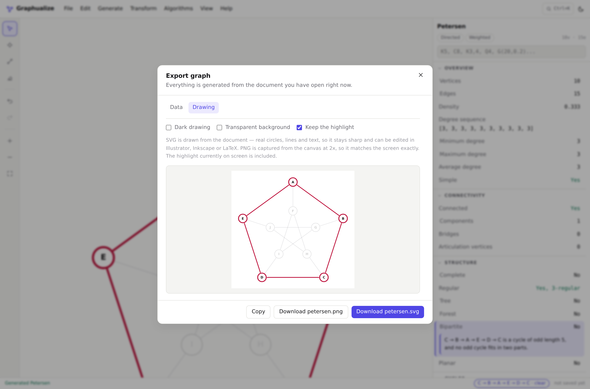

# Graphualize

**Draw graphs. Understand them.**

Graphualize is a workbench for graph theory. You draw a graph, its properties
update as you type, and clicking any property draws the mathematical reason on
the graph itself: the odd cycle that stops it being bipartite, the two vertices
that realise the diameter, the bridge whose removal disconnects it.

It runs entirely in the browser. No account, no server, no upload.

```
Create  →  Inspect  →  Understand  →  Manipulate
```

## Screenshots

The home page — the live demo at the top is the real analysis library running on
a real graph, not a picture of one:



The workbench, with the Petersen graph and the live inspector:



Clicking **Bipartite: No** highlights the odd cycle that proves it, and dims
everything else:



Dijkstra mid-run, with tentative distances on the vertices and the algorithm's
own priority queue below:



## Quick start

Two ways in.

**No install.** Build (or download) `Graphualize.html` and double-click it —
one file with the script, the stylesheet and the icon inlined, running straight
from `file://` with no server and no Node. The only thing it fetches is the web
font, which is a progressive enhancement: offline it falls back to your system
font and everything else works exactly the same.

```bash
npm install && npm run build:single   # produces Graphualize.html
```

Chrome, Edge and Firefox allow local storage on `file://` URLs, so saved graphs
survive a reload there. Safari does not, and Graphualize says so plainly instead
of pretending a save worked — export a file from **File → Export** instead, or
serve the page over `http://` where saving works everywhere.

The home page is at `/`, the workbench at `/#/graph`. Routing is done with the
URL hash rather than paths so that both work identically from a `file://` page
with no server to rewrite URLs. A link like `/#/graph?g=petersen` opens the
workbench with that graph already drawn.

**Development.** Hot reload, tests, the whole toolchain:

```bash
npm install
npm run dev      # http://localhost:5173
```

Requires Node 20 or newer.

## Commands

| Command | What it does |
|---|---|
| `npm run dev` | Vite dev server with hot reload |
| `npm run build` | Type-check the project and build to `dist/` |
| `npm run preview` | Serve the production build locally |
| `npm run build:single` | Build `Graphualize.html`, one self-contained file that runs from `file://` |
| `npm test` | Vitest unit and component tests (696 tests) |
| `npm run test:watch` | Vitest in watch mode |
| `npm run test:e2e` | Playwright end-to-end tests against a production build (24 tests) |
| `npm run typecheck` | `tsc` over the app, the tests and the e2e suite |
| `npm run lint` | oxlint |
| `npm run verify` | lint, build, unit tests and the auth config check in one go |
| `npm run setup:auth` | Create and configure the Supabase project for Google sign-in |
| `npm run verify:auth` | Check the sign-in configuration and scan for committed secrets |

Running the end-to-end suite for the first time needs a browser:
`npx playwright install chromium`. If your machine already has one, set
`PLAYWRIGHT_CHROMIUM_PATH=/path/to/chrome` instead.

## The idea

Most graph tools answer questions with a boolean. Graphualize answers with
evidence.

```
Bipartite                          No
  B → A → C → B is a cycle of odd length 3,
  and no odd cycle fits in two parts.

Eulerian circuit                   No
  4 vertices have odd degree. An Eulerian circuit
  needs every vertex to have even degree.

Diameter                            5
  The furthest pair is A and H. Distances count edges.
```

Every one of those rows is clickable, and clicking it draws the cycle, the
odd-degree vertices, or a realising shortest path on the canvas.

## The home page

`/` is a real front door rather than a splash screen: it explains what the tool
does, then demonstrates it. The graph in the hero is live — it runs the same
analysis library as the workbench, cycles through five properties and draws the
witness for each one, and you can drag its vertices around to watch the
mathematics stay put. A unit test asserts that the demo graph genuinely has the
properties the surrounding copy claims (three bridges, four articulation
vertices, diameter 5, an odd cycle of length 3), so the marketing cannot drift
away from the mathematics.

Every route into the product is one click: **Start drawing**, or a chip that
opens the workbench with `K5`, `C8`, the Petersen graph, `K3,3`, `Q4` or
`G(20,0.2)` already drawn, or any of the worked examples. If you have a graph in
progress the primary button changes to **Continue "…"** instead of throwing it
away. There is nothing to sign up for, so nothing asks you to.

## Getting around

| Key | Action |
|---|---|
| `V` / `N` / `E` / `X` | Select, vertex, edge, erase tools |
| `A` | Place a vertex at the centre of the view |
| `Ctrl/Cmd + K` | Command palette (also accepts `K5`, `C8`, `G(20,0.2)`) |
| `Ctrl/Cmd + Z` / `Ctrl/Cmd + Shift + Z` | Undo / redo |
| `F` | Fit the graph to the screen |
| `Delete` | Delete the selection |
| `Space`, `←`, `→` | Play/pause and step an algorithm |
| `?` | All shortcuts |

Right-click a vertex, an edge or empty canvas for the actions that apply to it —
run BFS from *this* vertex, contract *this* edge, take the induced subgraph of
the selection. Nothing lives only in that menu; it is a shortcut to things the
menu bar and the command palette can also reach.

Double-click a vertex to rename it, or an edge to change its weight. The
inspector's quick-input box takes the same shorthand as the palette:
`K5`, `C8`, `P12`, `K3,4`, `S6`, `W7`, `Q4`, `grid(3,4)`, `G(20,0.2)`,
`tree(12)`, `random(10,3)`, `petersen`.

## What it computes

### Overview
Vertices, edges, density, degree sequence, minimum/maximum/average degree,
simplicity (with the offending loops and repeated edges as a witness). Directed
graphs add in- and out-degree sequences, sources and sinks.

### Connectivity
Connected / weakly connected, connected components, bridges, articulation
vertices, strongly connected components, edge connectivity (Stoer–Wagner, or
max-flow for digraphs) and vertex connectivity (max-flow on the split graph).

### Structure
Complete, regular and *k*-regular, tree, forest, bipartite (with the two parts
or an odd cycle), complete bipartite K*m,n*, acyclicity and a topological order
for digraphs, and planarity.

### Cycles
Contains a cycle, girth, Eulerian circuit, Eulerian trail (both with the actual
walk, built by Hierholzer's algorithm) and the odd-degree vertices.

### Distance
All-pairs distances, eccentricity, diameter, radius, centre and periphery, with
weighted and unweighted semantics kept distinct. Negative cycles are reported
rather than silently producing nonsense.

### Colouring, cliques, matching
Greedy colouring under four orderings (document, largest-first, smallest-last
degeneracy, DSATUR), the chromatic number, the exact chromatic polynomial for
small graphs, maximum clique, maximum independent set, a greedy maximal
matching, and the maximum matching — Hopcroft–Karp on bipartite graphs,
Edmonds' blossom algorithm everywhere else.

### Spanning trees and spectrum
Minimum spanning tree or forest (Kruskal), the exact number of spanning trees by
the Matrix–Tree theorem using `bigint` arithmetic, adjacency and Laplacian
eigenvalues, and the algebraic connectivity.

### Matrices
Adjacency, degree, Laplacian, signless Laplacian, incidence and distance
matrices, each with its convention stated, copyable as plain text, CSV or LaTeX.

### Hamiltonicity
Exhaustive Held–Karp search under a stated size limit, plus cheap certificates
(a disconnected graph, or a vertex of degree below 2, is a proof of *no*).

## Algorithms you can step through

BFS, DFS, Dijkstra, Bellman–Ford, Prim, Kruskal, topological sort and greedy
colouring. Each emits a list of complete snapshots rather than animating
anything itself, so stepping backwards is exact and the same graph always
produces the same run.

During playback the canvas distinguishes the current vertex, visited vertices,
the frontier, the active edge, accepted tree edges and rejected edges, and the
panel below shows the algorithm's own state: the BFS queue, the DFS recursion
path, Dijkstra's priority queue and tentative distances, Kruskal's sorted edge
list, Prim's candidate edges, the current indegrees for a topological sort.

Beside the algorithm's name the player holds the run's own choices: **From**
for the algorithms that start somewhere, **To** for Dijkstra, which then ends on
the shortest path to that vertex, and **Order** for greedy colouring. Changing
one restarts the run from its first step. A vertex you selected before starting
is still where the run begins.

Dijkstra refuses to run on a graph with a negative edge and says to use
Bellman–Ford instead; Bellman–Ford extracts and highlights a negative cycle when
one exists.

## Generators

Path P*n*, cycle C*n*, complete K*n*, complete bipartite K*m,n*, star S*n*,
wheel W*n*, grid, hypercube Q*n*, the Petersen graph, complete trees, and three
random models: Erdős–Rényi G(*n*,*p*), a uniformly random labelled tree via a
Prüfer sequence, and a random *d*-regular graph via the configuration model.
Random generators take a seed and are fully deterministic.

## Transformations

Complement, transpose, induced subgraph, delete selected vertices or edges,
contract an edge, subdivide an edge, line graph, graph square, and conversion to
the underlying undirected graph. Each integrates with undo/redo and reports what
it did.

## Import and export

**Data.** Export to Graphualize JSON, adjacency list, adjacency matrix, CSV edge
list, Graphviz DOT and GraphML. Import detects the format automatically and
accepts Graphualize JSON, DOT, adjacency lists, adjacency matrices and CSV edge
lists. Invalid input produces a sentence explaining the problem, never a stack
trace.



**Drawing.** Export the picture as SVG or PNG. The SVG is written from the
document rather than screen-scraped from the canvas, so it is real circles,
lines and text — sharp at any size and editable in Illustrator, Inkscape or
LaTeX. Whatever witness or algorithm step is on screen can travel with it, so
the odd cycle you highlighted is still highlighted in the file you paste into
your write-up. PNG is captured from the canvas at 2× and matches the screen
exactly. Both offer a light or dark drawing and an optional transparent
background.

File → Save keeps a graph in the browser's local storage when you are signed
out, and in your Google account when you are signed in. Nothing is autosaved:
the working document is not restored on reload, and the browser warns before
leaving with unsaved changes. Generating, importing or opening an example puts a
*new* graph on screen rather than editing the saved one, so it takes that name
(unless you chose one) and Save cannot write it over the graph it replaced.

## Signing in (optional)

Graphualize works without an account and always will. Signing in adds one
thing: graphs you save go to your Google account, so they follow you between
devices. Graphs saved in this browser while signed out are copied into the
account the next time you sign in (and an edited one is copied again, onto the
same entry), and the local copies are kept. If the account cannot be reached, a
save falls back to this browser and is copied across once it can. With no
Supabase project configured — which is the default, and the case for the
single-file build — there is no account UI at all, no network request is made,
and saving simply uses this browser.

**If sign-in stops working.** Supabase pauses free-tier projects after a week
without activity. A paused project's hostname stops resolving, so sign-in and
account saves fail while local saving keeps working; the sign-in button says the
service is unavailable instead of redirecting into an error page. Resume the
project from its Supabase dashboard (data is kept) and everything comes back
without a redeploy. `npm run verify:auth` reports a paused project first.

To stop it happening, `vercel.json` schedules Vercel Cron to call
`/api/keepalive` (`api/keepalive.ts`) twice a day, and each call makes one read
with the publishable key, so the project never sits idle for a week. Crons run on production
deployments only, and the run log is under the project's Settings → Cron Jobs.
The endpoint reads nothing private, but setting a `CRON_SECRET` environment
variable in Vercel restricts it to Vercel Cron.

**Setting it up.** One command does everything that can be scripted:

```bash
SUPABASE_ACCESS_TOKEN=sbp_... npm run setup:auth
```

That creates the Supabase project, waits for it to provision, writes
`.env.local`, and allow-lists the development and preview redirect URLs. It then
prints the one thing that cannot be automated — the exact redirect URI to paste
into Google Cloud Console, because creating an OAuth client requires a Google
login and a consent screen. Paste it, then re-run with the credentials it gives
you back:

```bash
SUPABASE_ACCESS_TOKEN=sbp_... \
GOOGLE_CLIENT_ID=....apps.googleusercontent.com \
GOOGLE_CLIENT_SECRET=GOCSPX-... \
npm run setup:auth
```

When you have a production domain, add it with `SITE_URL=https://your-domain`
on the same command.

**Checking it.** `npm run verify:auth` reports what is actually configured —
whether the Google provider is enabled, what `SITE_URL` is, which redirect URLs
are allow-listed, and whether localhost and production are among them. With
`SUPABASE_ACCESS_TOKEN` set it reads the live project rather than guessing.

**Secrets.** Only two values reach the browser, both publishable by design:
`VITE_SUPABASE_URL` and `VITE_SUPABASE_ANON_KEY`. The Google client secret goes
straight from your shell to Supabase and never touches disk; the service-role
key is never referenced by this codebase at all. `.env*` is gitignored apart
from `.env.example`, and `verify:auth` fails the build if a client secret,
access token or service-role key ever appears in a file git would commit —
including untracked ones, since that is when a leak is most likely.

## Honesty about what is computed

This is the rule the whole product is built around: **Graphualize never presents
a heuristic as a proof.** Every result that cannot be computed exactly carries a
label saying so, and an explanation of why.

| Computation | Exact up to | Above that |
|---|---|---|
| Chromatic number | 24 vertices | An interval, e.g. `3–5`, with the bounds explained |
| Chromatic polynomial | 12 vertices | Not computed |
| Maximum clique / independent set | 46 vertices | A lower bound with a real witness |
| Hamiltonian cycle | 20 vertices | `Not computed` — never `No` |
| Maximum matching | 400 vertices | A greedy matching, labelled as a floor |
| Vertex connectivity | 60 vertices | Not computed |
| Edge connectivity | 120 vertices | Not computed |
| Planarity | 150 vertices | Not computed |
| Eigenvalues | 150 vertices | Not computed |
| Spanning tree count | 400 vertices | Not computed |
| All-pairs distances | 400 vertices | Not computed |

Two more points of care:

- **Eigenvalues are floating point.** They are labelled `heuristic`, and
  multiplicities are inferred by grouping values within 1e-7. An eigenvalue that
  looks like −2 is never described as exactly −2. The one number in that section
  labelled `exact` is the spanning tree count, which really is exact: it comes
  from fraction-free Bareiss elimination over `bigint`.
- **"Not computed" is not "no".** Hamiltonicity above the limit reports
  `Not computed`, and says in as many words that this is different from a
  negative answer.

## Architecture in one paragraph

`src/graph/` is a pure TypeScript library with no React and no Cytoscape in it.
It takes a `Graph` and returns data — including, wherever possible, a *witness*:
the cycle, the partition, the path, the matching that justifies the answer. The
UI decides how to draw that. Cytoscape is a view subscribed to the store, never
the source of truth, and every analysis is memoised against a structural hash
that deliberately excludes vertex positions, so dragging a vertex re-runs
nothing. See [ARCHITECTURE.md](./ARCHITECTURE.md) for the full picture.

## Known limitations

- **Planarity** is decided by Euler-bound certificates and Demoucron's path
  addition per biconnected block. It answers yes or no, but does not yet produce
  a Kuratowski subgraph as a witness for "no", or draw a planar embedding.
- **Graph comparison and isomorphism** are not implemented yet.
- **Max-flow / min-cut, Floyd–Warshall and SCC** exist inside the analysis layer
  but are not yet step-through visualisations.
- **Directed spectra.** A directed adjacency matrix can have complex
  eigenvalues, so Graphualize declines rather than showing real parts. Directed
  spanning-tree counting (Tutte's theorem, arborescences) is likewise out of
  scope for now.
- **Expensive computations run on the main thread.** They are size-gated so
  nothing freezes, but a Web Worker would let the limits rise. While an
  expensive analysis is settling, the medium-tier rows briefly show the previous
  graph's numbers — self-consistent, but up to 160 ms behind the canvas.
- **SVG export re-draws the graph** rather than reproducing the canvas
  pixel-for-pixel. Curvature of parallel edges and self-loops is recomputed with
  the exporter's own geometry, so a graph with many parallel edges can bundle
  slightly differently from the screen. PNG is the exact screen; SVG is the
  clean vector version of it.
- **Keyboard editing on the canvas** covers nudging, deleting, placing a vertex
  at the centre of the view (`A`) and every command in the palette, but a vertex
  cannot yet be placed at an arbitrary point without the mouse. Colour is backed
  up by shape for partition and colouring groups and by a legend during
  algorithm playback, but the witness colours themselves (path, cycle, matching,
  tree) are distinguished by colour and the caption in the status bar rather
  than by shape.
- **Mobile** works but is not the target; the canvas is small and there is no
  touch-specific edge gesture.

## Roadmap

The next three things worth building, in order:

1. **Graph comparison mode** — open two graphs side by side, diff their
   invariants, and run a VF2 isomorphism search that returns an explicit vertex
   mapping rather than inferring "isomorphic" from matching invariants.
2. **A Web Worker for the hard invariants** — move exact colouring, maximum
   clique, Hamiltonicity and the connectivity searches off the main thread so
   the size limits can rise substantially and the UI stays responsive while they
   run.
3. **Max-flow / min-cut as a visualisation** — the flow machinery already exists
   for connectivity; exposing it as a step-through algorithm with residual
   capacities on the edges is a natural next lesson.

After those: a Kuratowski-subgraph witness for non-planarity, and TikZ output
for people writing their answers up in LaTeX — the SVG exporter already has the
geometry, so it is mostly a second backend behind the same code.

## Licence

MIT.
